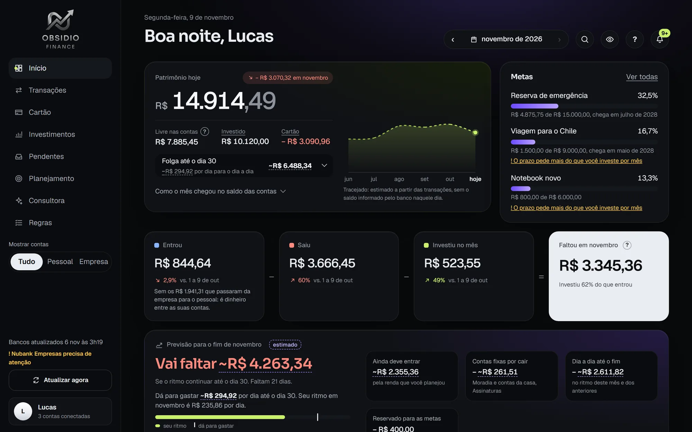

# Obsidio Finance

App de finanças pessoais que conecta as contas bancárias por Open Finance, separa cada gasto por categoria e mostra quanto ainda dá para gastar no mês. Está no ar desde outubro de 2026, em uso real por mim e por pessoas que convidei.

**Veja como ele funciona:** [mauriciorodrigues-ux.github.io/obsidio-finance](https://mauriciorodrigues-ux.github.io/obsidio-finance/)

Este repositório guarda só a página de apresentação. O código do app fica em repositório privado porque ele lida com dados bancários de pessoas reais. As imagens usam um usuário inventado para demonstração.

Feito por Maurício Rodrigues, estudante de Análise e Desenvolvimento de Sistemas, com desenvolvimento assistido por IA (Claude Code). A página explica o que foi decisão minha e o que foi feito pela IA.
